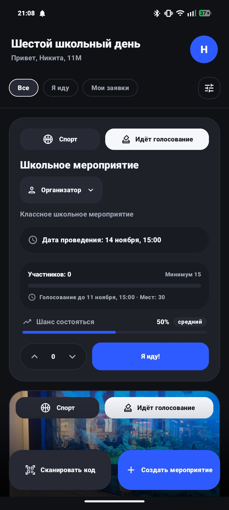
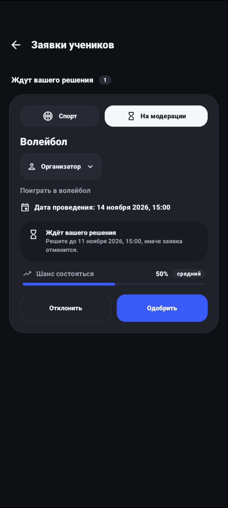
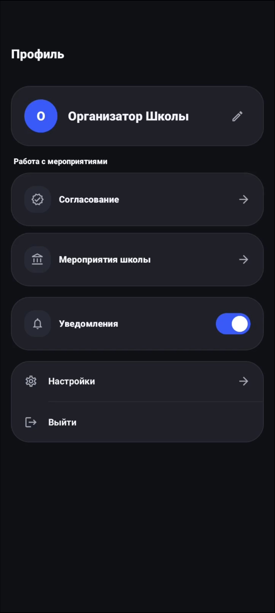
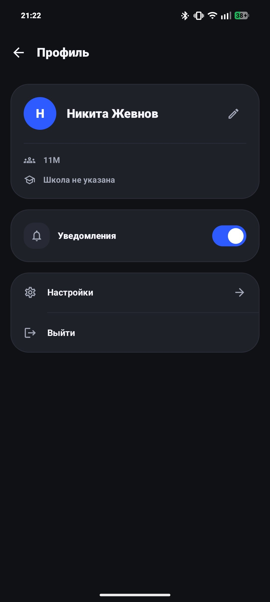
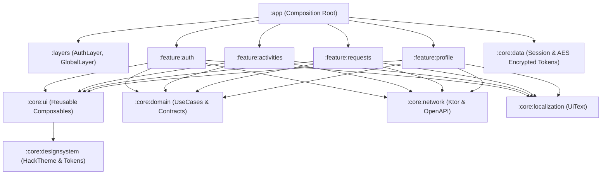

# Kola — Шестой школьный день

<p align="center">
  
  
  
  
  
  
  
  
</p>

---

## О проекте

**Kola** — это мобильное приложение для белорусских школ, превращающее «шестой школьный день» (субботние мероприятия) в прозрачный, увлекательный и демократичный процесс:

1. **Ученики** предлагают собственные инициативы (турниры по настольным играм, хакатоны, экологические рейды, волейбол, кинолектории).
2. **Классные руководители** проверяют и направляют инициативы своего класса.
3. **Школьники** голосуют («Я иду!») и в реальном времени собирают необходимый кворум.
4. **Администрация школы** выделяет кабинеты, спортзалы, актовые залы и утверждает проведение.
5. **Участники** мгновенно присоединяются к мероприятию и подтверждают явку по QR-коду с помощью Google ML Kit.

Проект интегрирован с единым образовательным порталом **Schools.by** для синхронизации классов и проверки прав доступа.

---

## Визуальная витрина интерфейсов на разных этапах

Интерфейс приложения адаптирован под ключевые роли пользователей:

<table align="center">
  <tr>
    <th width="33%" align="center">Ученик: Лента и голосование</th>
    <th width="33%" align="center">Учитель: Модерация заявки</th>
    <th width="33%" align="center">Организатор: Кабинет управления</th>
  </tr>
  <tr>
    <td align="center">
      
    </td>
    <td align="center">
      
    </td>
    <td align="center">
      
    </td>
  </tr>
  <tr>
    <td><sub>Выбор категорий, просмотр статуса голосования, индикатор шанса состояться и кнопка «Я иду!».</sub></td>
    <td><sub>Список заявок класса «На модерации», таймер на принятие решения, кнопки «Одобрить» и «Отклонить».</sub></td>
    <td><sub>Разделы согласования кворума, общешкольные мероприятия и управление уведомлениями.</sub></td>
  </tr>
</table>

### Подробный обзор экранов приложения

<details>
<summary><b>1. Лента мероприятий и открытое голосование учеников (развернуть)</b></summary>
<br>

<p align="center">
  
</p>

* **Фильтрация и вкладки**: быстрое переключение между разделами «Все», «Я иду» и «Мои заявки», а также выбор категорий (Спорт, Творчество, IT, Интеллект).
* **Информативная карточка инициативы**: содержит подтвержденное время проведения, порог кворума участников («Минимум 15») и дедлайн голосования.
* **Предиктивный индикатор**: блок «Шанс состояться» рассчитывает вероятность успешного сбора участников на основе текущей динамики.
* **Быстрые действия**: мгновенная подача голоса кнопкой «Я иду!», голосование за рейтинг инициативы и кнопка сканирования QR-кода на месте сбора.
</details>

<details>
<summary><b>2. Модерация заявок классным руководителем (развернуть)</b></summary>
<br>

<p align="center">
  
</p>

* **Входящая очередь класса**: отображаются все инициативы учеников со статусом «На модерации».
* **Контроль сроков**: таймер обратного отсчета предупреждает о дате автоматической отмены заявки, если решение не принято вовремя.
* **Принятие решения**: учитель в один клик одобряет инициативу для старта открытого голосования либо возвращает на доработку с обязательным комментарием.
</details>

<details>
<summary><b>3. Профиль пользователя и персональные настройки (развернуть)</b></summary>
<br>

<p align="center">
  
</p>

* **Идентификация учащегося**: отображение имени, привязанного класса (11М) и школы через шлюз Schools.by.
* **Управление push-уведомлениями**: мгновенный тумблер для включения и выключения оповещений о смене статусов мероприятий.
* **Параметры приложения**: быстрый переход в настройки темы оформления (темная, светлая, системная), языка интерфейса и безопасный выход из аккаунта.
</details>

<details>
<summary><b>4. Панель организатора школы и согласование ресурсов (развернуть)</b></summary>
<br>

<p align="center">
  
</p>

* **Координация шестого школьного дня**: доступ к списку инициатив, набравших необходимый кворум участников и готовых к согласованию.
* **Управление площадками**: распределение спортзалов, актовых залов и специализированных кабинетов.
* **Общешкольные события**: мониторинг всех утвержденных мероприятий школы на субботу.
</details>

---

## Архитектура приложения

Приложение разработано по Clean Architecture с однонаправленным потоком данных MVIKotlin и разделением на изолированные Gradle-модули.



### Главные технологические решения:
* **MVIKotlin**: Каждый экран управляется изолированным Store с чистым циклом `Intent -> Executor -> Message -> Reducer -> State -> UI` и `Label` для однократных событий.
* **Jetpack Navigation 3**: Полная типобезопасность навигации на этапе компиляции через `@Serializable NavKey`.
* **Session Gate**: Динамическое переключение между гостевым `AuthHost` и авторизованным `GlobalHost` с изоляцией бэкстека и отсутствием утечек данных.
* **Криптография**: Токены аутентификации хранятся в защищенном хранилище `EncryptedTokenStorage` с аппаратным шифрованием AES-256 GCM в Android Keystore.

---

## Документация (`documentation/`)

Подробная документация проекта:

* [**`documentation/USER_JOURNEY.md`**](./documentation/USER_JOURNEY.md) — Дорожная карта пользователя, 5 шагов воронки инициатив, сценарии ролей и наглядный пайплайн.
* [**`documentation/FEATURES_SPEC.md`**](./documentation/FEATURES_SPEC.md) — Инженерная спецификация фичей, MVI-сторы, доменные модели и контракты компонентов.
* [**`documentation/ARCHITECTURE.md`**](./documentation/ARCHITECTURE.md) — Архитектурный манифест, MVI-паттерн, граф модулей и внедрение зависимостей через Koin.
* [**`documentation/NAVIGATION_AND_LAYERS.md`**](./documentation/NAVIGATION_AND_LAYERS.md) — Маршрутизация в Navigation 3, система слоев и глубокие ссылки.
* [**`documentation/DESIGN_SYSTEM_AND_UI.md`**](./documentation/DESIGN_SYSTEM_AND_UI.md) — Токены HackExtras (glow, danger, success), типографика, компоненты и правила верстки.
* [**`documentation/NETWORK_AND_API.md`**](./documentation/NETWORK_AND_API.md) — Спецификация REST API OpenAPI 3.0, Ktor Client и парсер Schools.by.
* [**`documentation/NOTIFICATIONS_AND_DEEPLINKS.md`**](./documentation/NOTIFICATIONS_AND_DEEPLINKS.md) — Push-уведомления Firebase FCM и QR-сканер Google ML Kit.

---

## Технический стек

| Категория | Библиотека / Технология | Версия | Обоснование выбора |
| :--- | :--- | :---: | :--- |
| **Language** | Kotlin | `2.3.21` | Язык со строгой типизацией и корутинами |
| **UI Framework** | Jetpack Compose + Material 3 | `2026.05.01` | Декларативный UI без XML, тема HackTheme |
| **Navigation** | Jetpack Navigation 3 | `1.0.0` | Типобезопасные ключи навигации `@Serializable NavKey` |
| **Architecture** | MVIKotlin | `4.4.0` | Предсказуемый однонаправленный поток данных (UDF) |
| **DI** | Koin | `4.2.1` | Легковесное внедрение зависимостей |
| **Networking** | Ktor Client | `3.0.3` | Асинхронный HTTP-клиент с кастомным AuthPlugin |
| **Serialization** | kotlinx.serialization | `1.11.0` | Компиляторная сериализация JSON |
| **API Contract** | OpenAPI 3.0 Generator | `7.12.0` | Генерация DTO и сетевых интерфейсов из спецификации |
| **Security** | AndroidX Security Crypto | `1.1.0` | Аппаратное шифрование токенов AES-256 GCM |
| **Push** | Firebase Cloud Messaging (FCM) | `35.1.0` | Оповещения о смене статусов заявок |
| **QR Engine** | Google ML Kit + ZXing | `16.1.0` / `3.5.4` | Распознавание камерой и генерация QR-кодов |
| **Testing** | Turbine + JUnit + MockEngine | `1.2.0` | Реактивное тестирование Flow и сторов в изоляции |
| **Coverage** | Kotlinx Kover | `0.9.11` | Отчеты о покрытии кода тестами |

---

## Быстрый старт и запуск

### Требования к окружению:
* **JDK**: 17 или 21
* **Android Studio**: Ladybug / Meerkat (2024.2+)
* **Android SDK**: `compileSdk = 36`, `minSdk = 26` (Android 8.0+)

### Сборка и запуск приложения:
```bash
# Клонирование репозитория
git clone https://github.com/your-username/lbsuhack.git
cd lbsuhack

# Сборка Debug APK
./gradlew assembleDebug

# Запуск на подключенном устройстве/эмуляторе
./gradlew installDebug
```

### Запуск модульных тестов:
```bash
# Тестирование конкретной фичи:
./gradlew :feature:activities:testDebugUnitTest
./gradlew :feature:requests:testDebugUnitTest
./gradlew :feature:auth:testDebugUnitTest

# Полный прогон всех тестов и генерация отчета Kover:
./gradlew testDebugUnitTest
./gradlew :koverHtmlReport
```
*HTML-отчет о покрытии: `build/reports/kover/html/index.html`.*
