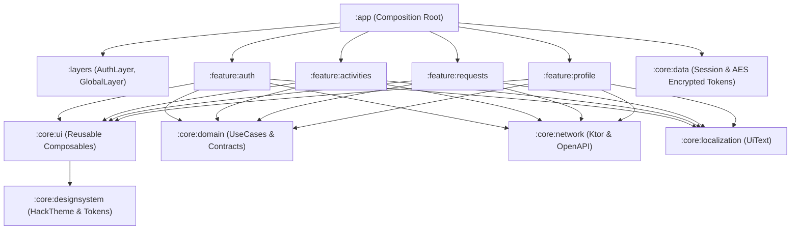

# Kola — Шестой школьный день 🎓✨

<p align="center">
  
  
  
  
  
  
  
  
</p>

---

## 💡 О проекте

**Kola** — это мобильная экосистема для белорусских школ, превращающая «шестой школьный день» (субботние мероприятия) в прозрачный, увлекательный и демократичный процесс:

1. **Ученики** предлагают собственные инициативы (турниры по настольным играм, хакатоны, экологические рейды, волейбол, кинолектории).
2. **Классные руководители** проверяют и направляют инициативы своего класса.
3. **Школьники** голосуют («Я иду!») и в реальном времени собирают необходимый кворум.
4. **Администрация школы** выделяет кабинеты, спортзалы, актовые залы и утверждает время.
5. **Участники** мгновенно присоединяются к мероприятию и подтверждают явку по **QR-коду** с помощью Google ML Kit.

Проект глубоко интегрирован с единым образовательным порталом **Schools.by** для бесшовного входа, синхронизации классов и проверки прав доступа.

---

## 🎬 Визуальная витрина фичей на разных этапах

Ниже представлена наглядная схема того, как инициатива проходит путь от черновика до проведения, и как выглядит интерфейс для разных ролей:

<table align="center">
  <tr>
    <th width="33%" align="center">📱 Ученик: Создание и сбор голосов</th>
    <th width="33%" align="center">👨‍🏫 Учитель: Модерация заявки</th>
    <th width="33%" align="center">🏛 Администрация: Утверждение</th>
  </tr>
  <tr>
    <td align="center">
      <!-- Замените на documentation/assets/gifs/activity-create.webp после записи скринкаста -->
      
    </td>
    <td align="center">
      <!-- Замените на documentation/assets/gifs/teacher-moderation.webp после записи скринкаста -->
      
    </td>
    <td align="center">
      <!-- Замените на documentation/assets/gifs/admin-approval.webp после записи скринкаста -->
      
    </td>
  </tr>
  <tr>
    <td><sub>Выбор 1 из 10 категорий, загрузка обложки, выбор охвата (класс / параллель / школа) и порога кворума.</sub></td>
    <td><sub>Проверка заявки ученика своего класса, одобрение или возврат на доработку с обязательным комментарием.</sub></td>
    <td><sub>Проверка готовности кворума, выбор кабинета или спортзала, назначение точного времени проведения.</sub></td>
  </tr>
</table>

### Интерактивные демо ключевых сценариев:

<details>
<summary><b>🔥 1. Этап сбора голосов и прогресс кворума (Нажмите, чтобы развернуть)</b></summary>
<br>

<p align="center">
  
</p>

* В карточке отображается динамический прогресс кворума: $\text{votesCount} / \text{voteThreshold}$.
* Одноклассники нажимают кнопку **«Я иду!»**, аватары участников появляются в реальном времени.
* По достижении порога заявка автоматически отправляется на согласование администрации.
</details>

<details>
<summary><b>📷 2. Мгновенный переход к мероприятию по QR-коду (Нажмите, чтобы развернуть)</b></summary>
<br>

<p align="center">
  
</p>

* Каждое утвержденное мероприятие содержит встроенный QR-код схемы `kola://activity/{id}`.
* Встроенный сканер Google ML Kit Barcode Scanner открывает мероприятие за 0.3 секунды без запроса системных разрешений.
</details>

---

## 🗺 Стадии жизненного цикла инициативы

| Стадия | Системный статус | Роль-инициатор | Доступные действия | Визуальный индикатор |
| :---: | :---: | :---: | :--- | :---: |
| **1** | `ON_MODERATION` | Ученик | Подача заявки, валидация полей, загрузка фото обложки | 🟡 `На модерации` |
| **2** | `ON_VOTE` | Учитель | Одобрение заявки, старт открытого голосования в классе | 🔵 `Идёт голосование` |
| **3** | `ON_ADMIN_MODERATION` | Система (Кворум) | Достижение кворума $\ge$ порога, передача дирекции | 🟣 `У администрации` |
| **4** | `FINALIZED` | Администрация | Назначение кабинета и времени, генерация QR-кода | 🟢 `Утверждено` |
| **Терминал** | `DECLINED` / `EXPIRED` | Учитель / Таймер | Отклонение с обоснованной причиной или недобор кворума | 🔴 `Отклонено` |

> 📖 *Подробный разбор механики всех этапов читайте в документе: [**`documentation/FEATURES_AND_STAGES.md`**](./documentation/FEATURES_AND_STAGES.md)*.

---

## 🏗 Архитектура приложения

Приложение разработано по строгим канонам **Clean Architecture** с однонаправленным потоком данных **MVIKotlin** и разделением на изолированные Gradle-модули.



### Главные технологические решения:
* **MVIKotlin**: Каждый экран управляется изолированным Store с чистым циклом `Intent -> Executor -> Message -> Reducer -> State -> UI` и `Label` для однократных событий.
* **Jetpack Navigation 3**: Полная типобезопасность навигации на этапе компиляции через `@Serializable NavKey`.
* **Session Gate**: Динамическое переключение между гостевым `AuthHost` и авторизованным `GlobalHost` с изоляцией бэкстека и отсутствием утечек данных.
* **Криптография**: Токены аутентификации хранятся в защищенном хранилище `EncryptedTokenStorage` с аппаратным шифрованием **AES-256 GCM** в Android Keystore.

---

## 📚 Техническая документация (`documentation/`)

Вся подробная техническая документация разделена по отдельным тематическим файлам:

* 🚀 [**`documentation/FEATURES_AND_STAGES.md`**](./documentation/FEATURES_AND_STAGES.md) — Каталог всех фичей, 5 стадий жизненного цикла, матрица ролей и демо-плейсхолдеры.
* 🎬 [**`documentation/DEMO_AND_MEDIA_GUIDE.md`**](./documentation/DEMO_AND_MEDIA_GUIDE.md) — Руководство по записи гифок, оптимизации WebP и красивому оформлению медиа на GitHub.
* 🏗 [**`documentation/ARCHITECTURE.md`**](./documentation/ARCHITECTURE.md) — Архитектурный манифест, MVI-паттерн, граф модулей и внедрение зависимостей через Koin.
* 🧭 [**`documentation/NAVIGATION_AND_LAYERS.md`**](./documentation/NAVIGATION_AND_LAYERS.md) — Маршрутизация в Navigation 3, система слоев и глубокие ссылки.
* 🎨 [**`documentation/DESIGN_SYSTEM_AND_UI.md`**](./documentation/DESIGN_SYSTEM_AND_UI.md) — Токены HackExtras (glow, danger, success), типографика, компоненты и правила чистой верстки.
* 🌐 [**`documentation/NETWORK_AND_API.md`**](./documentation/NETWORK_AND_API.md) — Спецификация REST API OpenAPI 3.0, Ktor Client и парсер Schools.by.
* 🔔 [**`documentation/NOTIFICATIONS_AND_DEEPLINKS.md`**](./documentation/NOTIFICATIONS_AND_DEEPLINKS.md) — Push-уведомления Firebase FCM и QR-сканер Google ML Kit.
* 🧪 [**`documentation/TESTING_AND_CI.md`**](./documentation/TESTING_AND_CI.md) — Тестирование со сторами Turbine, Kover coverage и регламент параллельной работы.

---

## 🛠 Технический стек

| Категория | Библиотека / Технология | Версия | Обоснование выбора |
| :--- | :--- | :---: | :--- |
| **Language** | Kotlin | `2.3.21` | Современный язык со строгой типизацией и корутинами |
| **UI Framework** | Jetpack Compose + Material 3 | `2026.05.01` | Декларативный UI без XML, кастомная тема HackTheme |
| **Navigation** | Jetpack Navigation 3 | `1.0.0` | Типобезопасные ключи навигации `@Serializable NavKey` |
| **Architecture** | MVIKotlin | `4.4.0` | Предсказуемый однонаправленный поток данных (UDF) |
| **DI** | Koin | `4.2.1` | Легковесное и быстрое внедрение зависимостей без кодогенерации |
| **Networking** | Ktor Client | `3.0.3` | Асинхронный HTTP-клиент с кастомным AuthPlugin |
| **Serialization** | kotlinx.serialization | `1.11.0` | Быстрая компиляторная сериализация JSON |
| **API Contract** | OpenAPI 3.0 Generator | `7.12.0` | Генерация DTO и сетевых интерфейсов из спецификации |
| **Security** | AndroidX Security Crypto | `1.1.0` | Аппаратное шифрование токенов AES-256 GCM |
| **Push** | Firebase Cloud Messaging (FCM) | `35.1.0` | Мгновенные оповещения о смене статусов заявок |
| **QR Engine** | Google ML Kit + ZXing | `16.1.0` / `3.5.4` | Быстрое распознавание камерой и генерация QR-кодов |
| **Testing** | Turbine + JUnit + MockEngine | `1.2.0` | Реактивное тестирование Flow и сторов в изоляции |
| **Coverage** | Kotlinx Kover | `0.9.11` | Объединенные отчеты о покрытии кода тестами |

---

## 🚀 Быстрый старт и запуск

### Требования к окружению:
* **JDK**: 17 или 21
* **Android Studio**: Ladybug / Meerkat (2024.2+)
* **Android SDK**: `compileSdk = 36`, `minSdk = 26` (Android 8.0+)

### Сборка и запуск приложения:
```bash
# Клонирование репозитория
git clone https://github.com/your-username/lbsuhack.git
cd lbsuhack

# Сборка Debug APK
./gradlew assembleDebug

# Запуск на подключенном устройстве/эмуляторе
./gradlew installDebug
```

### Запуск модульных тестов:
```bash
# Тестирование конкретной фичи:
./gradlew :feature:activities:testDebugUnitTest
./gradlew :feature:requests:testDebugUnitTest
./gradlew :feature:auth:testDebugUnitTest

# Полный прогон всех тестов и генерация отчета Kover:
./gradlew testDebugUnitTest
./gradlew :koverHtmlReport
```
*HTML-отчет о покрытии будет доступен в: `build/reports/kover/html/index.html`.*
