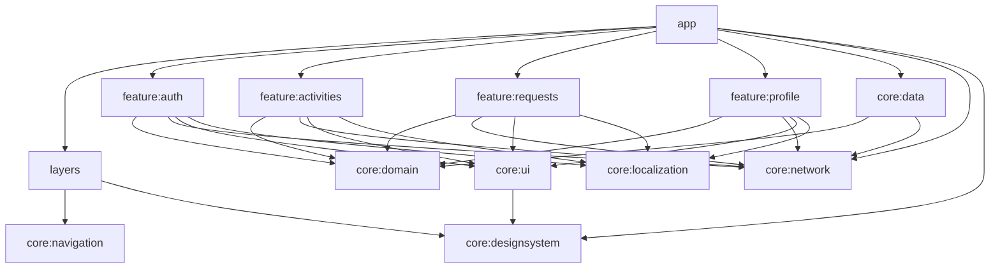
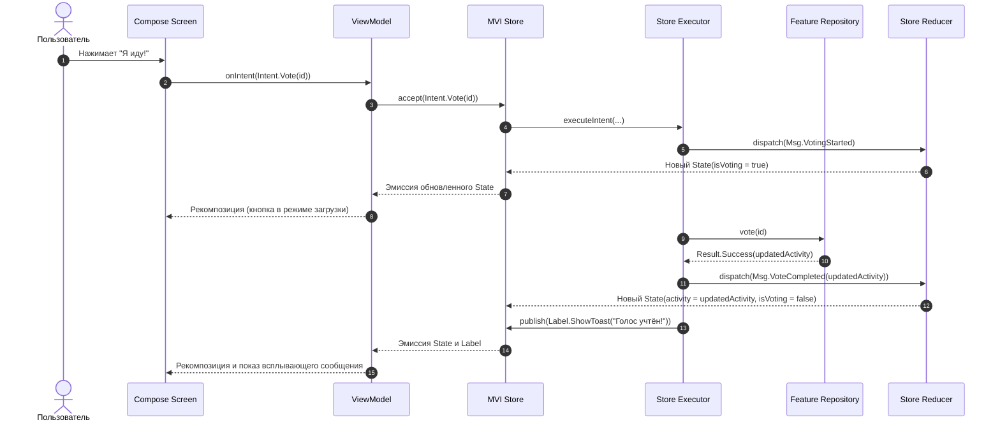

# Архитектура проекта и технический стек

В этом документе детально описаны архитектурные принципы, шаблоны проектирования, граф зависимостей модулей и механизмы управления состоянием в приложении **Kola («Шестой школьный день»)**.

---

## 1. Обзор архитектуры (High-Level Overview)

Проект построен на принципах **Clean Architecture** с применением строгого паттерна **MVI (Model-View-Intent)** на базе библиотеки **MVIKotlin** и современной компонентной модели **Jetpack Compose + Navigation 3**.

### Архитектурные слои:

```mermaid
graph TD
    subgraph UI ["Слой представления (Presentation & UI)"]
        UI_Screens["Jetpack Compose Screens\n(Single-concern composables)"]
        UI_VM["AndroidX ViewModel\n(Store holder & lifecycle bridge)"]
    end

    subgraph MVI ["Слой управления состоянием (MVIKotlin)"]
        Store["Store\n(StateFlow<State>, Labels)"]
        Executor["Executor\n(Бизнес-логика, вызовы репозиториев)"]
        Reducer["Reducer\n(Чистые функции мутации состояния)"]
    end

    subgraph Domain ["Доменный слой (Domain Layer)"]
        UseCases["Use Cases (в core:domain)"]
        DomainModels["Domain Models (Чистый Kotlin)"]
        RepoInterfaces["Repository Interfaces"]
    end

    subgraph Data ["Слой данных (Data Layer)"]
        RepoImpl["Repository Implementations"]
        DataSources["Data Sources (Remote, Local, Cache)"]
        KtorClient["Ktor 3.x Client + AuthPlugin"]
        EncryptedStorage["EncryptedTokenStorage (AES-256 GCM)"]
    end

    UI_Screens -->|Intents| UI_VM
    UI_VM -->|Intents| Store
    Store --> Executor
    Executor -->|Messages| Reducer
    Reducer -->|Новый State| Store
    Store -->|State & Labels| UI_VM
    UI_VM -->|StateFlow| UI_Screens

    Executor --> RepoInterfaces
    UseCases --> RepoInterfaces
    RepoImpl ..|> RepoInterfaces
    RepoImpl --> DataSources
    DataSources --> KtorClient
    DataSources --> EncryptedStorage
```

---

## 2. Модульная структура репозитория

Проект организован как мультимодульный Gradle-репозиторий со строгим разграничением зон ответственности и конвеншн-плагинами в `build-logic`.

```text
├── app/                  # Главная точка сборки (Composition root), MainActivity, Gate сессии
├── layers/               # Навигационные слои приложения (AuthLayer, GlobalLayer)
├── feature/              # Вертикальные фиче-срезы (Feature Slices)
│   ├── auth/             # Авторизация, интеграция с Schools.by, выбор класса
│   ├── activities/       # Лента активностей, создание, деталка, голосование, QR-сканер
│   ├── requests/         # Модерация инициатив учителем и администрацией
│   └── profile/          # Профиль пользователя, темы, языки, настройки уведомлений
└── core/                 # Общая инфраструктура и разделяемые возможности
    ├── designsystem/     # Дизайн-система (HackTheme, токены, типографика, HackExtras)
    ├── ui/               # Библиотека переиспользуемых Compose-компонентов
    ├── domain/           # Контракты сессии, базовые модели пользователей, Use Cases
    ├── data/             # Реализация хранилища сессии, токенов, пользователей
    ├── navigation/       # Инфраструктура Navigation 3, AppNavigator, AppEventBus
    ├── network/          # Ktor-клиент, OpenAPI генерация, шифрование токенов
    └── localization/     # Многоязычность (UiText, LanguageController)
```

### Модульный граф зависимостей:



---

## 3. Однонаправленный поток данных (UDF в MVIKotlin)

В приложении исключены двусторонние привязки и мутабельные переменные в UI. Каждый экран реализует строгий цикл MVIKotlin:

1. **Intent**: Действие пользователя или системы (например, `LoginStore.Intent.Submit`, `ActivitiesStore.Intent.Vote`).
2. **Executor**: Принимает Intent, запускает корутины, вызывает сетевые или дисковые репозитории, отправляет `Message` в Reducer и при необходимости генерирует одноразовые `Label`.
3. **Message**: Внутреннее атомарное сообщение об изменении состояния (`Msg.LoadingStarted`, `Msg.DataLoaded`, `Msg.ErrorOccurred`).
4. **Reducer**: Чистая функция `(State, Message) -> State`. Вычисляет новое неизменяемое (`data class`) состояние.
5. **State**: Потоковое состояние экрана, транслируемое во `ViewModel` и отображаемое через Compose `collectAsStateWithLifecycle()`.
6. **Label**: Однократные побочные эффекты (Single Event Effects): навигация, показ Snackbar, закрытие диалога.



---

## 4. Навигация нового поколения: Jetpack Navigation 3

Проект использует **Jetpack Navigation 3** — полностью типобезопасный API навигации без строковых URL-роутов.

### Ключевые архитектурные решения:
* **Типобезопасные ключи (`NavKey`)**:
  Все маршруты — это `@Serializable` объекты или дата-классы:
  ```kotlin
  @Serializable data object ActivitiesRoute : NavKey
  @Serializable data object CreateActivityRoute : NavKey
  @Serializable data class ActivityDetailsRoute(val activityId: String) : NavKey
  ```
* **Шлюз сессий (`AppRootScreen`)**:
  Приложение отслеживает `SessionState` (`Unknown` $\to$ `Unauthenticated` $\to$ `Authenticated`).
  При изменении состояния сессии пересоздается корневой хост с уникальным ключом `key(AUTH_HOST_KEY)` или `key(GLOBAL_HOST_KEY)`, что гарантирует **полный сброс и изоляцию стека переходов** между гостевой и авторизованной зонами.
* **Слои (`NavigationLayer` и `SceneStrategy`)**:
  Слои навигации (`AuthLayer`, `GlobalLayer`) комбинируются с помощью функциональной композиции:
  ```kotlin
  layers.map { it.sceneStrategy }.foldRight(SinglePaneSceneStrategy()) { strategy, acc ->
      strategy.then(acc)
  }
  ```
* **Изоляция скоупов экранов (`rememberViewModelStoreNavEntryDecorator`)**:
  Каждая запись в бэкстеке получает собственный изолированный `ViewModelStore`. Это предотвращает утечки данных между экранами и очищает память сразу при выходе с экрана.

---

## 5. Внедрение зависимостей (Koin Dependency Injection)

Внедрение зависимостей построено на **Koin 4.x** с модульной декомпозицией:

* Каждый модуль декларирует ровно один публичный модуль, например: `val activitiesModule = module { ... }`.
* Фабрики сторов регистрируются как синглтоны: `singleOf(::ActivitiesStoreFactory)`.
* ViewModels регистрируются через `viewModelOf(::ActivitiesViewModel)`.
* В `App.kt` происходит запуск Koin со всеми модулями.
* Внутри экранов зависимости инжектируются через `koinViewModel()` или `koinInject()`. Service Locator внутри фичей строго запрещен.

---

## 6. Безопасность и хранение сессий

1. **Шифрование токенов**:
   - `EncryptedTokenStorage` сохраняет JWT Access и Refresh токены с использованием Android Keystore и симметричного алгоритма **AES-256 GCM**.
   - Прямой доступ к сырым токенам из UI или репозиториев запрещен: Ktor `AuthPlugin` автоматически подставляет заголовок `Authorization: Bearer <token>` и производит бесшовное обновление токена при получении HTTP 401.
2. **Хук очистки сессии (`SessionClearHook`)**:
   - При выходе из аккаунта срабатывает каскадная очистка: аннулирование токенов на сервере, удаление FCM-токена устройства, сброс кэша в памяти и безопасное стирание ключей шифрования.
