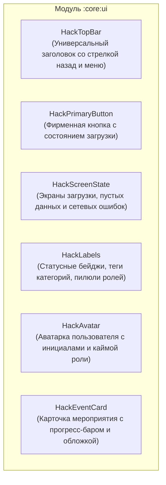

# Дизайн-система и архитектура пользовательского интерфейса

В этом документе описаны принципы дизайн-системы, палитра токенов, кастомные расширения тем оформления и правила верстки в приложении **Kola («Шестой школьный день»)**.

---

## 1. Концепция дизайн-системы (`core:designsystem`)

Дизайн-система приложения сочетает стандарты **Material Design 3** с фирменной технологичной эстетикой («Hack / Cyber-School»). 

### Ключевые принципы:
- **Сохранение фирменного стиля**: Функция Material You `dynamicColor` намеренно отключена, чтобы системные цвета устройства не переопределяли бренд-палитру.
- **Единый источник правды**: Все цвета, типографика и формы считываются строго через `MaterialTheme`. В коде фичей запрещены прямые вызовы `Color(0xFF...)`.
- **Бесшовная смена тем**: Переключение тем (Светлая / Тёмная / Системная) выполняется как реактивная рекомпозиция без перезапуска `Activity`.

---

## 2. Цветовая палитра и расширенные токены (`HackExtras`)

Помимо стандартных слотов `MaterialTheme.colorScheme`, в приложении реализованы кастомные токены через `HackExtras` (`MaterialTheme.hack`):

| Токен | Назначение | Тёмная тема (Dark) | Светлая тема (Light) |
| :--- | :--- | :--- | :--- |
| `glow` | Неоновое свечение активных карточек и акцентов | `#00E5FF` (Cyan Neon) | `#0091EA` (Deep Cyan) |
| `success` | Утвержденные мероприятия, кворум набран | `#00E676` (Neon Green) | `#2E7D32` (Forest Green) |
| `danger` | Отклоненные заявки, критические ошибки | `#FF1744` (Vibrant Red) | `#D50000` (Deep Red) |
| `gridLine` | Тонкие разделительные линии и сетка | `rgba(255, 255, 255, 0.08)` | `rgba(0, 0, 0, 0.08)` |

### Моделирование режимов темы:
```kotlin
enum class AppThemeMode {
    SYSTEM,
    LIGHT,
    DARK,
}
```
Хранение и восстановление выбранного режима осуществляется через `ThemeController` и `ThemePreferences` с кодированием через `ThemeModeCodec`.

---

## 3. Типографика и специальные стили

В дизайн-системе помимо стандартного текста внедрены два специализированных стиля:

1. **`HackMonoTextStyle`**:
   - Предназначен для технических данных: ID мероприятий, QR-кодов, шифрованных ссылок `kola://activity/{id}`, счетчиков голосов.
   - Использует моноширинную гарнитуру (`FontFamily.Monospace`) с плотным межбуквенным расстоянием.
2. **`HackTimerTextStyle`**:
   - Крупные цифры для дедлайнов голосования, счетчиков прогресса кворума и таймлайнов.
   - Высокий контраст и четкость считывания с одного взгляда.

---

## 4. Библиотека общих компонентов (`core:ui`)

Модуль `core:ui` содержит высокоуровневые, готовые к переиспользованию виджеты, не привязанные к конкретной бизнес-логике или роутам.



### Правила использования компонентов `core:ui`:
- Компоненты принимают чистые типы: `String`, `Boolean`, лямбда-колбэки `() -> Unit`.
- В компоненты `core:ui` **запрещено** передавать доменные сущности (`ActivityProposal`), роуты навигации или специфичные `UiText`.
- Каждый компонент обязан содержать превью для темной и светлой тем:
  ```kotlin
  @Preview(name = "Dark")
  @Composable
  private fun PreviewDark() {
      HackTheme(mode = AppThemeMode.DARK) { /* Компонент */ }
  }

  @Preview(name = "Light")
  @Composable
  private fun PreviewLight() {
      HackTheme(mode = AppThemeMode.LIGHT) { /* Компонент */ }
  }
  ```

---

## 5. Стандарты декомпозиции пользовательского интерфейса

В соответствии с правилами проекта, в коде UI соблюдается строгая модульность:

1. **Запрет на монолитные файлы UI**:
   - Запрещено создавать файлы-свалки вида `*Components.kt` или помещать несколько сложных компонентов в один файл.
   - **Один экран — один главный Composable** в файле `ui/<screen>/<ScreenName>Screen.kt`.
2. **Иерархия пакетов UI внутри фичи**:
   ```text
   ui/
   ├── <screen>/
   │   ├── <ScreenName>Screen.kt         # Точка входа в экран (Scaffold, сборка состояния)
   │   ├── component/                    # Узкоспециализированные подкомпоненты экрана
   │   │   ├── ActivityHeroCard.kt
   │   │   ├── StatusTimelineCard.kt
   │   │   └── VotingStatusCard.kt
   │   └── dialog/                       # Диалоговые окна данного экрана
   │       ├── ApproveDialog.kt
   │       └── DeclineDialog.kt
   └── component/                         # Компоненты, общие для нескольких экранов фичи
   ```
3. **Чистота кода**:
   - Бизнес-логика, расчеты кворума и парсинг вынесены в Store и Domain-слои.
