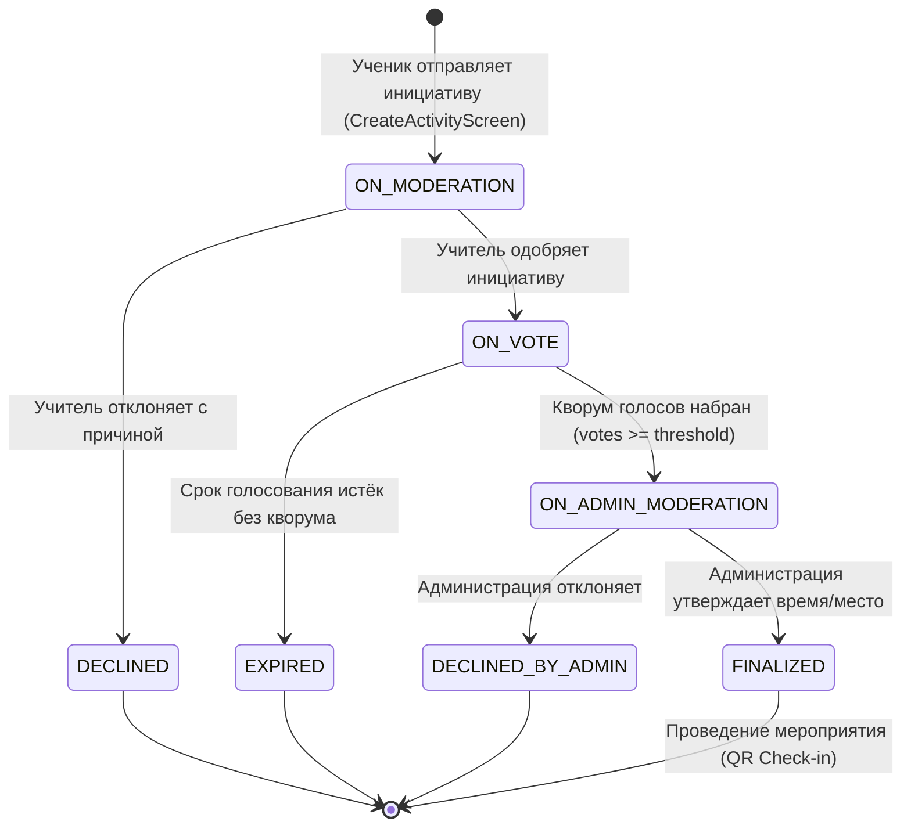

# Каталог фичей и жизненный цикл активности на всех этапах

В данном документе приведено исчерпывающее техническое и функциональное описание всех возможностей приложения **Kola («Шестой школьный день»)** с разбиением по стадиям жизненного цикла, ролям пользователей и модульной структуре.

---

## 1. Концепция проекта и модель жизненного цикла

Приложение автоматизирует организацию мероприятий шестого школьного дня (субботних активностей) в школах Республики Беларусь. Ученики предлагают свои инициативы (от киберспорта и настольных игр до субботников и туристических походов), проходят ступенчатую модерацию классными руководителями и администрацией школы, собирают кворум участников и получают утвержденное расписание и аудитории.

### Граф состояний инициативы (`ActivityStatus`):



---

## 2. Детальный разбор стадий жизненного цикла

### Этап 1. Создание и модерация учителем (`ON_MODERATION`)

```text
[ Инициатива создана ] ──► [ Проверка классным руководителем ]
```

* **Цель этапа**: Отсеять некорректные или небезопасные предложения на уровне класса до выноса на всеобщее обозрение.
* **Кто участвует**: Автор (ученик) и классный руководитель данного класса.
* **Что происходит в системе**:
  1. Ученик заполняет форму: название, подробное описание, категория, целевая аудитория (`CLASS`, `GRADE`, `SCHOOL`), порог кворума (минимальное число желающих), прикрепляет фото обложки.
  2. Инициатива сохраняется со статусом `ON_MODERATION`.
  3. Заявка моментально появляется во вкладке **«Заявки»** (`feature:requests`) у учителя класса.
  4. Учитель видит карточку заявки с данными ученика и принимает решение:
     - **Одобрить**: инициатива получает статус `ON_VOTE` и становится доступна для голосования.
     - **Отклонить**: учитель обязан указать причину отклонения (до 2000 символов). Инициатива переходит в `DECLINED`.
* **Визуализация на экране**:
  - Карточка отображает бейдж `На модерации` (желтый акцент).
  - На таймлайне этапов подсвечен шаг **1: Создано**.
  - Кнопка голосования заблокирована.

---

### Этап 2. Сбор кворума и открытое голосование (`ON_VOTE`)

```text
[ Голосование открыто ] ──► [ Сбор голосов «Я иду!» ] ──► [ Достижение порога ]
```

* **Цель этапа**: Подтвердить реальный интерес учеников к мероприятию.
* **Кто участвует**: Все ученики целевой аудитории (класс, параллель или вся школа).
* **Что происходит в системе**:
  1. Карточка появляется в общей ленте мероприятий во вкладках **«Все»** и **«Голосование»**.
  2. Ученики могут:
     - Нажать кнопку **«Я иду!»** (голос за участие).
     - Поставить лайк/реакцию.
     - Поделиться ссылкой или QR-кодом мероприятия.
  3. Прогресс-бар кворума (`ActivityVoteProgress`) в реальном времени пересчитывает отношение:
     $$\text{Progress} = \min\left(1.0, \frac{\text{votesCount}}{\text{voteThreshold}}\right)$$
  4. При достижении кворума ($\text{votesCount} \ge \text{voteThreshold}$) сервер автоматически переводит заявку в статус `ON_ADMIN_MODERATION`.
  5. Если дедлайн наступил, а кворум не набран, заявка переходит в статус `EXPIRED` («Не состоялось»).
* **Визуализация на экране**:
  - Бейдж статуса: `Идёт голосование` (сине-бирюзовый акцент).
  - На таймлайне подсвечен шаг **3: Набор участников**.
  - Активная динамическая кнопка «Я иду!» / «Вы идёте» (с возможностью отзыва голоса).
  - Список аватаров и имен участников: «Иван, Анна и ещё 7 человек».

---

### Этап 3. Утверждение администрацией школы (`ON_ADMIN_MODERATION`)

```text
[ Кворум набран ] ──► [ Проверка администрацией ] ──► [ Выделение ресурсов ]
```

* **Цель этапа**: Согласование школьной инфраструктуры (спортзал, актовый зал, компьютерный класс, сопровождение педагогов).
* **Кто участвует**: Администратор школы / организатор (`UserRole.ORGANIZATOR`).
* **Что происходит в системе**:
  1. Заявка отображается в специальном фильтре модерации администратора (`audience = ADMIN`).
  2. Администратор видит, что мероприятие поддержано кворумом, состав участников и контакты ответственного педагога.
  3. Администратор принимает финальное решение:
     - **Утвердить**: указывает подтвержденное время проведения (`confirmedTime`) и локацию. Статус меняется на `FINALIZED`.
     - **Отклонить**: указывает причину отказа (например, «Спортзал занят городскими соревнованиями»). Статус меняется на `DECLINED_BY_ADMIN`.
* **Визуализация на экране**:
  - Бейдж статуса: `У администрации` (пурпурно-оранжевый акцент).
  - Таймлайн: шаг **4: Согласование**.
  - Голосование заморожено, но разрешены лайки и добавление в закладки.

---

### Этап 4. Утверждённое мероприятие (`FINALIZED`)

```text
[ Мероприятие подтверждено ] ──► [ Подготовка и Check-in по QR ]
```

* **Цель этапа**: Финальный анонс, сбор участников в субботу и проведение активности.
* **Что происходит в системе**:
  1. Мероприятие попадает во вкладку **«Утверждённые»**.
  2. В карточке и на детальном экране появляется блок с точной датой, временем и кабинетом (`ConfirmedActivityInfo`).
  3. Формируется персональный QR-код мероприятия (`kola://activity/{id}`) для быстрого перехода участников и проверки явки на месте.
* **Визуализация на экране**:
  - Бейдж: `Утверждено` (зеленый неоновый статус `HackExtras.success`).
  - Таймлайн: шаг **5: Утверждено** (все точки соединены сплошной линией).
  - Отображение блока с подтвержденным временем и кнопка шеринга.

---

## 3. Матрица возможностей по ролям (Role & Permission Matrix)

| Функция / Действие | Ученик (`PUPIL`) | Учитель (`TEACHER`) | Администратор (`ORGANIZATOR`) |
| :--- | :---: | :---: | :---: |
| Вход через Schools.by с выбором класса | ✅ | ✅ | ✅ |
| Просмотр ленты мероприятий | ✅ | ✅ | ✅ |
| Создание инициативы на субботу | ✅ | ❌ | ❌ |
| Загрузка фото обложки к мероприятию | ✅ | ❌ | ❌ |
| Голосование «Я иду!» за участие | ✅ (кроме своих) | ❌ | ❌ |
| Лайк / поддержка инициативы | ✅ | ✅ | ✅ |
| Сканирование QR-кодов через камеру | ✅ | ✅ | ✅ |
| Модерация заявок своего класса | ❌ | ✅ | ❌ |
| Утверждение заявок с выделением залов | ❌ | ❌ | ✅ |
| Отклонение заявки с указанием причины | ❌ | ✅ (класс) | ✅ (школа) |
| Переключение темы оформления (Dark/Light) | ✅ | ✅ | ✅ |
| Смена языка (RU / EN / System) | ✅ | ✅ | ✅ |
| Управление push-уведомлениями | ✅ | ✅ | ✅ |

---

## 4. Обзор функциональных модулей

### 4.1. Модуль авторизации (`feature:auth`)
* **Маршрут**: `AuthLoginRoute`
* **Ключевые компоненты**:
  - `SchoolsByRemoteDataSource` & `SchoolsByProfileParser`: осуществляют прямое защищенное взаимодействие с порталом Schools.by, извлекая ФИО, список доступных классов и школы.
  - `LoginStore`: MVI-стор, управляющий шагами входа (`LoginStep.Credentials` $\to$ `LoginStep.ClassSelection`).
  - `AuthClassPicker` & `ClassDropdownMenu`: удобный выбор учебного класса с автофильтрацией.
  - Демо-режим (`AuthDemoBanner`): возможность быстрого тестирования под разными преднастроенными ролями.

### 4.2. Модуль активностей (`feature:activities`)
* **Маршруты**:
  - `ActivitiesRoute`: главная витрина событий с фильтрацией по 10 категориям (`SPORTS`, `INTELLECTUAL`, `CULTURAL`, `CREATIVE`, `EDUCATIONAL`, `VOLUNTEER`, `ENVIRONMENTAL`, `TOURISM`, `ENTERTAINMENT`, `OTHER`) и вкладкам статусов.
  - `CreateActivityRoute`: пошаговый мастер создания инициативы с валидацией, превью обложки и выбором охвата.
  - `ActivityDetailsRoute(activityId)`: подробный экран мероприятия с интерактивным таймлайном `StatusTimelineCard`, списком участников, кнопками вовлечения и QR-кодом.
* **Инновации модуля**:
  - Встроенный сканер Google ML Kit Barcode Scanner (`ActivityScanButton`).
  - Генерация ссылок схемы `kola://activity/{id}` для мгновенного шаринга.
  - Двухуровневый кэш в памяти (`MemoryLruDataSource`).

### 4.3. Модуль модерации заявок (`feature:requests`)
* **Маршрут**: `RequestsRoute(role: UserRole)`
* **Ключевые компоненты**:
  - Динамическая фильтрация аудитории (`RequestAudience.TEACHER` vs `RequestAudience.ADMIN`).
  - `ApproveDialog`: диалог быстрого подтверждения заявки.
  - `DeclineDialog`: строгий диалог отклонения с валидацией обязательной причины отказа (до 2000 символов), чтобы ученик понимал, что нужно исправить.
  - Разделение на вкладки: **«В ожидании»** и **«Обработанные»**.

### 4.4. Модуль профиля и настроек (`feature:profile`)
* **Маршруты**: `ProfileRoute`, `ProfileSettingsRoute`
* **Ключевые компоненты**:
  - Карточка пользователя с бейджем роли и информацией о школе/классе.
  - Интерактивный переключатель темы (`ThemeModeSelector`): Светлая, Тёмная, Системная.
  - Селектор языка приложения (`LanguageSelector`): Русский, English, Системный.
  - Переключатель push-уведомлений о статусах заявок.
  - `LogoutDialog`: безопасный выход с полным уничтожением криптографических сессионных ключей.

---

## 5. Заготовки и плейсхолдеры для демонстраций (GIF / WebP)

Ниже приведены готовые посадочные блоки для вставки демонстраций в репозиторий.

### 5.1. Демо: Путь ученика от идеи до голосования

```html
<p align="center">
  <!-- Вставьте documentation/assets/gifs/pupil-flow.webp после записи -->
  
</p>
```

### 5.2. Демо: Модерация учителем и администрацией

```html
<p align="center">
  <!-- Вставьте documentation/assets/gifs/moderation-flow.webp после записи -->
  
</p>
```

### 5.3. Демо: Сканирование QR-кода и мгновенный переход

```html
<p align="center">
  <!-- Вставьте documentation/assets/gifs/qr-scan-flow.webp после записи -->
  
</p>
```
