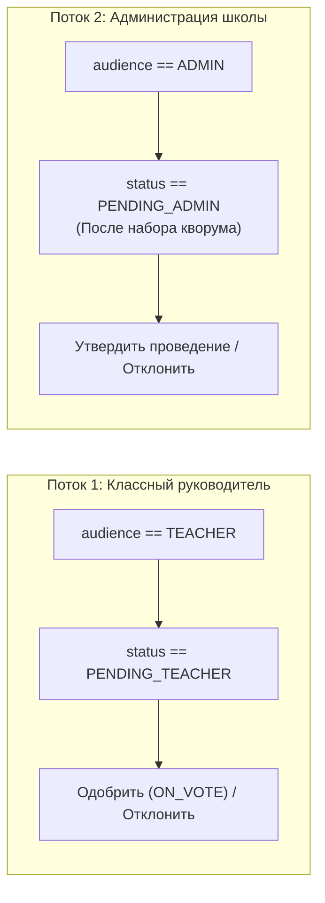

# Техническая спецификация фичей и компонентов (Features Spec)

В этом документе представлена детальная инженерная спецификация модулей, MVI-сторов, доменных моделей и контрактов пользовательского интерфейса приложения **Kola («Шестой школьный день»)**.

---

## 1. Архитектурный стандарт вертикального среза (Feature Slice)

Каждый модуль в директории `feature/*` следует строгому соглашению о структуре пакетов:

```text
feature/<name>/src/main/kotlin/.../feature/<name>/
  data/          DTO, мапперы, API-сервисы, реализации репозиториев, кэш
  domain/        Чистые Kotlin-модели и интерфейсы репозиториев (без Android SDK и UiText)
  presentation/  AndroidX ViewModel для каждого экрана (мост между жизненным циклом и Store)
  store/         Контракты MVIKotlin Store (Intent, Message, State, Label) и фабрики StoreFactory
  ui/            Compose-экраны:
                 ├── <screen>/<ScreenName>Screen.kt   (Точка входа)
                 ├── <screen>/component/              (Подкомпоненты конкретного экрана)
                 ├── <screen>/dialog/                 (Диалоговые окна)
                 └── component/                       (Переиспользуемые виджеты фичи)
  navigation/    Маршруты NavKey и NavigationInstaller
  di/            Публичный модуль Koin: val <name>Module = module { ... }
```

## 3. Модуль мероприятий и активностей (`feature:activities`)

### 3.1. Доменная модель `ActivityProposal`
Основная доменная сущность инициативы:

```kotlin
data class ActivityProposal(
    val id: String,
    val title: String,
    val description: String,
    val category: ActivityCategory,
    val scope: ActivityScope = ActivityScope.CLASS,
    val status: ActivityStatus,
    val voteThreshold: Int,
    val votesCount: Int,
    val hasVoted: Boolean,
    val startsAt: String = "",
    val votingClosesAt: String = "",
    val createdAt: String = "",
    val authorName: String,
    val teacherName: String? = null,
    val declineReason: String? = null,
    val photoUri: String? = null,
    val confirmedTime: String? = null,
    val voters: List<String> = emptyList(),
    val likesCount: Int = 0,
    val likedByMe: Boolean = false,
    val isMine: Boolean = false,
) {
    // Вычисляемые бизнес-свойства:
    val isQuorumReached: Boolean get() = votesCount >= voteThreshold
    val progress: Float get() = if (voteThreshold > 0) (votesCount.toFloat() / voteThreshold).coerceIn(0f, 1f) else 0f
    val canChangeVote: Boolean get() = status == ActivityStatus.ON_VOTE
    val canLike: Boolean get() = status in listOf(
        ActivityStatus.ON_VOTE, 
        ActivityStatus.ON_ADMIN_MODERATION, 
        ActivityStatus.FINALIZED, 
        ActivityStatus.DECLINED_BY_ADMIN
    )
    val canShare: Boolean get() = status == ActivityStatus.ON_VOTE || status == ActivityStatus.FINALIZED
}
```

### 3.2. Категории и перечисления
* **`ActivityCategory`**: `SPORTS`, `INTELLECTUAL`, `CULTURAL`, `CREATIVE`, `EDUCATIONAL`, `VOLUNTEER`, `ENVIRONMENTAL`, `TOURISM`, `ENTERTAINMENT`, `OTHER`.
* **`ActivityScope`**: `CLASS` (свой класс), `GRADE` (параллель), `SCHOOL` (вся школа).
* **`ActivityStatus`**: `ON_MODERATION`, `DECLINED`, `ON_VOTE`, `EXPIRED`, `ON_ADMIN_MODERATION`, `FINALIZED`, `DECLINED_BY_ADMIN`.

### 3.3. Сторовые компоненты модуля
1. **`ActivitiesStore`** (Лента активностей):
   - Вкладки (`ActivityTab`): `ALL`, `RECRUITING`, `PENDING_ADMIN`, `APPROVED`, `MY_PROPOSALS`, `MY_PARTICIPATIONS`.
   - Оптимистичное обновление: при нажатии `Vote` или `Like` счетчик изменяется мгновенно в UI до ответа сервера. При сетевой ошибке состояние откатывается.
2. **`CreateActivityStore`** (Мастер создания):
   - Валидация: заголовок от 5 до 128 символов, описание от 10 до 2000 символов, обязательный выбор категории и порога кворума.
   - Загрузка изображения: асинхронный multipart-запрос через `/api/v1/events/{id}/image` с поддержкой повторной попытки (`SubmitActivityActions`).
3. **`ActivityDetailsStore`** (Детальный экран):
   - Загрузка профилей проголосовавших участников.
   - Генерация QR-кода активности через `ZXing` в фоновом пуле корутин.

### 3.4. Аппаратное сканирование (Google ML Kit)
- Компонент `ActivityScanButton` инициализирует `GmsBarcodeScanning.getClient()` с включенным автофокусом и распознаванием формата `Barcode.FORMAT_QR_CODE`.
- Ссылки валидируются через объект `ActivityLink`:
  ```kotlin
  object ActivityLink {
      fun create(activityId: String): String = "kola://activity/$activityId"
      fun parse(value: String?): String? { /* Валидация схемы kola://activity/{id} */ }
  }
  ```

---

## 4. Модуль модерации заявок (`feature:requests`)

### 4.1. Разделение потоков модерации
Модуль обслуживает два уровня проверки:



### 4.2. Доменная модель `ReviewRequest`
```kotlin
data class ReviewRequest(
    val id: String,
    val title: String,
    val description: String,
    val proposedDate: OffsetDateTime?,
    val authorName: String,
    val status: ReviewStatus,
    val audience: RequestAudience,
    val declineReason: String? = null,
    val voters: List<String> = emptyList(),
    val votesCount: Int = 0,
    val voteThreshold: Int = 0,
    val likesCount: Int = 0,
)
```

### 4.3. Диалоговые контроллеры
* **`ApproveDialog`**: Диалог подтверждения заявки. При подтверждении администратором позволяет указать назначенную локацию и время.
* **`DeclineDialog`**: Диалог отклонения заявки. Валидирует обязательное текстовое поле `declineReason` (длина до 2000 символов, не пустое). Предотвращает отклонение без объяснения причин.

---

## 5. Модуль профиля и настроек (`feature:profile`)

### 5.1. Управление темой оформления
* `ThemeController` из `core:designsystem` управляет режимом `AppThemeMode` (`SYSTEM`, `LIGHT`, `DARK`).
* Выбор сохраняется в `KeyValueStorage` через `ThemePreferences`.
* `ThemeModeSelector` рендерит компактные радио-карточки с немедленной сменой палитры `HackTheme`.

### 5.2. Управление локализацией
* Контроллер `LanguageController` из `core:localization` переключает язык на уровне системных конфигураций приложения без перезапуска процесса:
  - `AppLanguage.SYSTEM`
  - `AppLanguage.RUSSIAN` (`ru`)
  - `AppLanguage.ENGLISH` (`en`)

### 5.3. Завершение сессии (Secure Logout)
* При подтверждении выхода в `LogoutDialog`:
  1. Вызывается `ClearSessionUseCase`.
  2. Срабатывает `PushTokenSync.unregister()`, отправляющий запрос на удаление токена устройства с сервера.
  3. `TokenStorage.clear()` очищает криптографические ключи из Keystore.
  4. Сессионный шлюз `AppRootScreen` демонтирует дерево навигации `GLOBAL_HOST_KEY` и возвращает пользователя на `AuthLoginRoute`.

---

## 6. Матрица технических разрешений (Backend & Role Scopes)

| Функция / Эндпоинт | JWT Scopes | PUPIL | TEACHER | ORGANIZATOR |
| :--- | :--- | :---: | :---: | :---: |
| `POST /api/v1/events` | `events:create` | ✅ | ❌ | ❌ |
| `POST /api/v1/events/{id}/image` | `events:upload` | ✅ | ❌ | ❌ |
| `POST /api/v1/events/{id}/vote` | `events:vote` | ✅ | ❌ | ❌ |
| `POST /api/v1/events/{id}/approve` | `moderation:teacher` | ❌ | ✅ | ❌ |
| `POST /api/v1/events/{id}/decline` | `moderation:teacher` | ❌ | ✅ | ❌ |
| `POST /api/v1/events/{id}/admin/approve` | `moderation:admin` | ❌ | ❌ | ✅ |
| `POST /api/v1/events/{id}/admin/decline` | `moderation:admin` | ❌ | ❌ | ✅ |
| `POST /api/v1/device-token` | `push:manage` | ✅ | ✅ | ✅ |
| `GET /api/v1/events` | `events:read` | ✅ | ✅ | ✅ |
