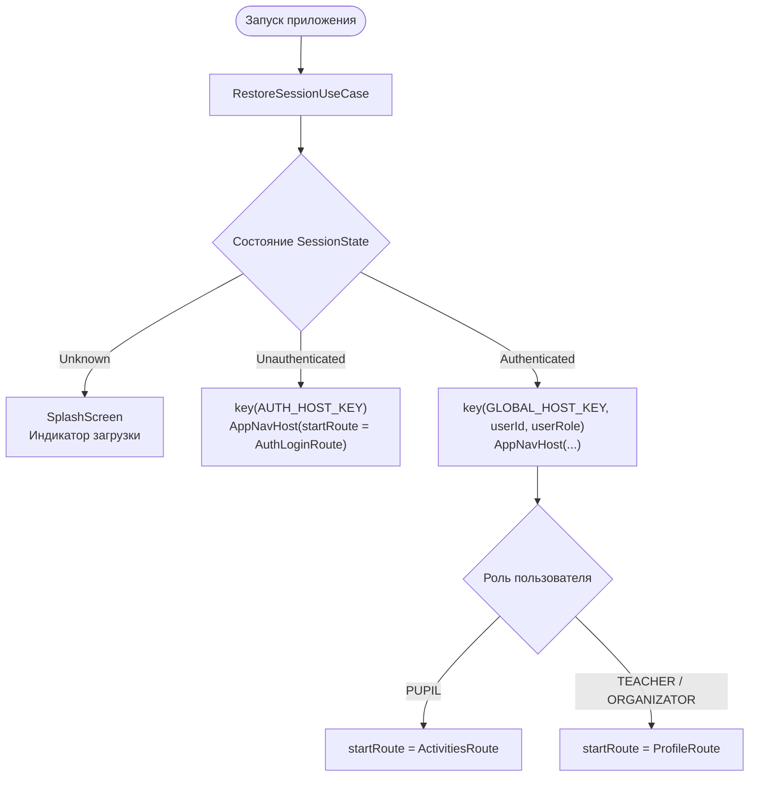
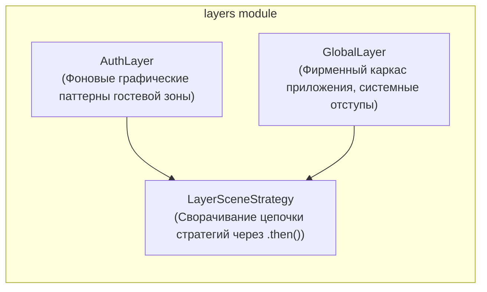

# Навигация и система слоев (Navigation 3 & Layers)

В этом документе описывается архитектура навигации приложения **Kola («Шестой школьный день»)** на базе библиотеки **Jetpack Navigation 3**, система слоев оформления и типобезопасная маршрутизация.

---

## 1. Концепция навигации в Navigation 3

В отличие от устаревших строковых URL-роутов Jetpack Navigation 2.x, проект использует **Navigation 3** со следующими ключевыми преимуществами:

* **Типобезопасность на этапе компиляции**: Маршруты представляют собой сериализуемые Kotlin-классы (`NavKey`). Ошибки в параметрах исключены на уровне компилятора.
* **Явное управление бэкстеком**: Стек навигации — это реактивный список `rememberNavBackStack(startRoute)`, которым управляет `Navigator`.
* **Слои декораторов (`NavEntryDecorator`)**:
  - `rememberSaveableStateHolderNavEntryDecorator`: автоматическое сохранение UI-состояния при переходах.
  - `rememberViewModelStoreNavEntryDecorator`: персональный скоуп `ViewModelStore` для каждого экрана, предотвращающий утечки памяти.
* **Композиция стратегий отображения (`SceneStrategy`)**: Возможность комбинировать разные сценарии рендеринга (SinglePane, SplitPane, Modal).

---

## 2. Каталог маршрутов приложения (`NavKey`)

Все маршруты объявлены в подпакетах `navigation/` соответствующих фич и реализуют маркерный интерфейс `NavKey`:

| Модуль | Класс маршрута | Параметры | Описание экрана |
| :--- | :--- | :--- | :--- |
| **`feature:auth`** | `AuthLoginRoute` | — | Экран авторизации через Schools.by и выбора класса |
| **`feature:activities`** | `ActivitiesRoute` | — | Главная витрина инициатив субботнего дня с фильтрами |
| **`feature:activities`** | `CreateActivityRoute` | — | Мастер создания нового субботнего мероприятия |
| **`feature:activities`** | `ActivityDetailsRoute` | `activityId: String` | Детальный экран мероприятия, голосование, таймлайн и QR |
| **`feature:requests`** | `RequestsRoute` | `role: UserRole` | Панель модерации заявок для учителей и дирекции |
| **`feature:profile`** | `ProfileRoute` | — | Профиль пользователя, роль, статистика активности |
| **`feature:profile`** | `ProfileSettingsRoute` | — | Настройки темы оформления, языка и уведомлений |

---

## 3. Шлюз сессий (`AppRootScreen` Session Gate)

Корневой экран `AppRootScreen` выступает главным диспетчером жизненного цикла приложения, реагируя на `SessionState`:



### Гарантия безопасности перехода:
Использование `key(AUTH_HOST_KEY)` и `key(GLOBAL_HOST_KEY)` в Compose гарантирует, что при входе или выходе из учетной записи дерево навигации полностью демонтируется. Это физически предотвращает возврат назад по системной кнопке «Назад» на экраны авторизации из защищенной зоны и наоборот.

---

## 4. Архитектура слоев (`layers`)

Модуль `layers` отделяет визуальное обрамление экранов от их содержимого:



* **`NavigationLayer`**: Интерфейс слоя, предоставляющий метаданные и кастомную стратегию `SceneStrategy<NavKey>`.
* **Сворачивание слоев**: При запуске `AppNavHost` слои объединяются методом `foldRight`:
  ```kotlin
  val combinedStrategy = remember(layers) {
      val defaultStrategy: SceneStrategy<NavKey> = SinglePaneSceneStrategy()
      layers.map { it.sceneStrategy }.foldRight(defaultStrategy) { strategy, acc ->
          strategy.then(acc)
      }
  }
  ```

---

## 5. Межмодульная навигация без связности

По архитектурному регламенту модули `feature:*` не имеют права зависеть друг от друга. Для переходов между экранами разных фичей используется интерфейс `AppNavigation` из `core:navigation`:

```kotlin
interface AppNavigation {
    fun openProfile()
    fun openRequests(role: UserRole)
}
```

* Фичи вызывают `LocalAppNavigation.current.openProfile()`, не зная о существовании модуля `feature:profile`.
* Реализация интерфейса собирается в модуле `app`, где доступны все модули, и связывается с `AppNavigator`.

---

## 6. Глубокие ссылки (Deep Links) и переход по QR-кодам

Приложение поддерживает открытие конкретных мероприятий через QR-коды и push-уведомления:

1. **Формат ссылки**: `kola://activity/{activityId}` (валидируется объектом `ActivityLink`).
2. **Маршрутизация**:
   - При холодном старте (например, по клику на уведомление) параметр `pendingActivityId` передается в `MainActivity` $\to$ `AppRootScreen`.
   - После подтверждения аутентификации `AppRootScreen` автоматически вызывает переход на `ActivityDetailsRoute(pendingActivityId)` и сбрасывает pending-флаг через `onActivityLinkConsumed()`.
   - Внутри приложения сканер `ActivityScanButton` распознает QR-код с помощью Google ML Kit и моментально выполняет переход.
