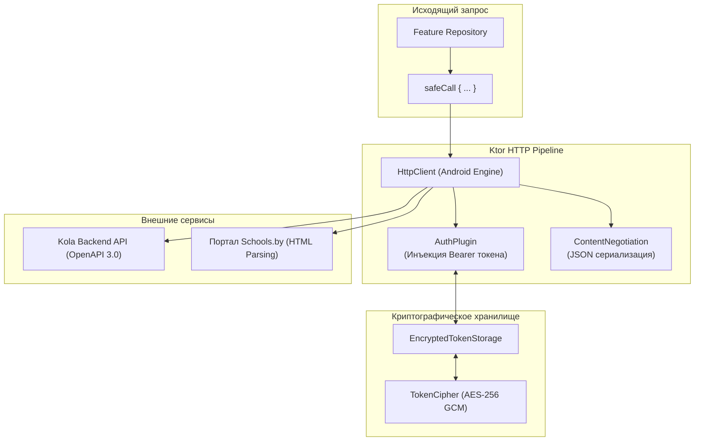

# Сетевой слой и спецификация API (Network & OpenAPI)

В данном документе приведено детальное описание сетевой архитектуры приложения **Kola («Шестой школьный день»)**, спецификация API бэкенда, генерация моделей через OpenAPI и механизм интеграции со сторонним сервисом Schools.by.

---

## 1. Архитектура сетевого стека (`core:network`)

Сетевой слой приложения построен на базе **Ktor 3.x** и **kotlinx.serialization**.

### Ключевые компоненты:
1. **`AppHttpClientFactory`**: Инициализирует Ktor-клиент с таймаутами подключения (15 сек), обработкой редиректов и сериализатором JSON (`ignoreUnknownKeys = true`, `coerceInputValues = true`).
2. **`AuthPlugin`**:
   - Автоматически инжектирует заголовок `Authorization: Bearer <accessToken>` для всех защищенных запросов.
   - Перехватывает ошибку `401 Unauthorized`, выполняет потокобезопасное обновление токена через мьютекс и перезапускает упавший запрос.
   - Если токен обновить невозможно, транслирует сигнал очистки сессии.
3. **`EncryptedTokenStorage`**:
   - Использует симметричное шифрование **AES-256 GCM** с ключом, надежно изолированным в аппаратном модуле Android Keystore.
4. **Безопасные вызовы (`safeCall`)**:
   Оборачивает HTTP-запросы в монадический результат `NetworkResult<T>`:
   - `NetworkResult.Success(data)`
   - `NetworkResult.Failure.Http(statusCode, errorBody)`
   - `NetworkResult.Failure.Network(ioException)`
   - `NetworkResult.Failure.Serialization(exception)`

---

## 2. Спецификация REST API (`api/openapi.yaml`)

Все модели данных и клиенты генерируются автоматически плагином `org.openapi.generator` на основе единого файла контракта `api/openapi.yaml`.

### 2.1. Аутентификация и пользователи (Auth & Users)

| Метод | Эндпоинт | Доступ | Описание |
| :--- | :--- | :---: | :--- |
| `POST` | `/api/v1/auth/register` | Public | Регистрация / вход по ID из Schools.by. Возвращает JWT токен. |
| `POST` | `/api/v1/auth/login` | Public | Вход по логину и паролю. |
| `GET` | `/api/v1/users` | Bearer | Список пользователей с фильтрацией по роли и классу. |
| `GET` | `/api/v1/users/{id}` | Bearer | Получение профиля конкретного пользователя. |
| `PATCH` | `/api/v1/users/{id}` | Bearer | Обновление информации пользователя. |

### 2.2. Мероприятия и активности (Events)

| Метод | Эндпоинт | Доступ | Описание |
| :--- | :--- | :---: | :--- |
| `GET` | `/api/v1/events` | Bearer | Получение ленты мероприятий с фильтрацией (категория, статус, охват). |
| `POST` | `/api/v1/events` | Bearer (PUPIL) | Создание новой инициативы учеником со статусом `ON_MODERATION`. |
| `GET` | `/api/v1/events/{id}` | Bearer | Полная информация о мероприятии (участники, статус, таймлайн). |
| `POST` | `/api/v1/events/{id}/image` | Bearer (PUPIL) | Загрузка фотографии обложки (Multipart/form-data). |
| `POST` | `/api/v1/events/{id}/vote` | Bearer (PUPIL) | Голос «Я иду!» за участие в мероприятии (продвигает кворум). |
| `DELETE` | `/api/v1/events/{id}/vote` | Bearer (PUPIL) | Отзыв своего голоса до закрытия голосования. |
| `POST` | `/api/v1/events/{id}/like` | Bearer | Реакция / лайк мероприятию. |
| `DELETE` | `/api/v1/events/{id}/like` | Bearer | Удаление реакции. |
| `GET` | `/api/v1/events/my` | Bearer | Список инициатив, созданных текущим пользователем. |
| `GET` | `/api/v1/events/voting` | Bearer | Список активностей, в которых пользователь участвует голосом. |
| `POST` | `/api/v1/events/probability` | Bearer | Прогноз вероятности утверждения мероприятия (AI/ML эвристика). |

### 2.3. Модерация заявок (Moderation)

| Метод | Эндпоинт | Роль | Описание |
| :--- | :--- | :---: | :--- |
| `GET` | `/api/v1/events/moderation` | `TEACHER` | Список заявок учеников своего класса, ожидающих модерации. |
| `POST` | `/api/v1/events/{id}/approve` | `TEACHER` | Одобрение заявки учителем $\to$ перевод в статус `ON_VOTE`. |
| `POST` | `/api/v1/events/{id}/decline` | `TEACHER` | Отклонение заявки с обязательным комментарием причины. |
| `GET` | `/api/v1/events/admin-moderation` | `ORGANIZATOR` | Список заявок школы, успешно собравших кворум. |
| `POST` | `/api/v1/events/{id}/admin/approve` | `ORGANIZATOR` | Финальное утверждение дирекцией, назначение времени и локации. |
| `POST` | `/api/v1/events/{id}/admin/decline` | `ORGANIZATOR` | Отклонение заявки администрацией с комментарием. |

### 2.4. Push-уведомления (Device Tokens)

| Метод | Эндпоинт | Описание |
| :--- | :--- | :--- |
| `POST` | `/api/v1/device-token` | Регистрация FCM-токена устройства пользователя. |
| `DELETE` | `/api/v1/device-token` | Удаление токена устройства при выходе из аккаунта. |

---

## 3. Интеграция с сервисом Schools.by

Поскольку в школах Республики Беларусь официальным электронным дневником и журналом является платформа **Schools.by**, приложение Kola предоставляет бесшовный шлюз авторизации.

### Схема интеграции:
1. **Парсинг веб-сессии (`SchoolsByRemoteDataSource`)**:
   - Выполняется защищенный POST-запрос авторизации к веб-форме Schools.by.
   - Извлекаются сессионные cookies (`sessionid`, `csrftoken`).
2. **Анализ профиля (`SchoolsByProfileParser`)**:
   - Выполняется запрос к личному кабинету пользователя.
   - HTML-парсер извлекает:
     * Фамилию, Имя и Отчество.
     * Номер и название школы.
     * Роль (ученик, учитель или родитель).
     * Список привязанных классов (для ученика — его текущий класс; для учителя — классы, где он является классным руководителем).
3. **Обмен на Kola JWT**:
   - Приложение передает валидированный `schoolsById` и профиль на эндпоинт бэкенда `/api/v1/auth/register`, получая в ответ нативный JWT access-токен для работы с активностями и модерацией.
