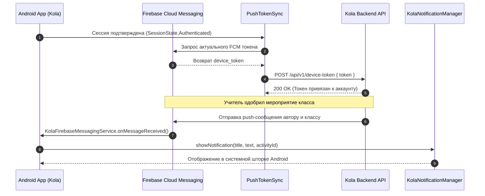
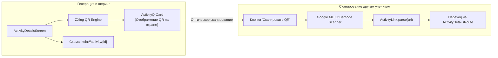

# Push-уведомления и система QR-кодов (FCM & Deep Links)

В этом документе описывается реализация push-уведомлений через **Firebase Cloud Messaging (FCM)**, синхронизация токенов устройств и механизм обмена ссылками/QR-кодами на основе **Google ML Kit** и **ZXing**.

---

## 1. Архитектура Push-уведомлений (FCM)

Приложение информирует участников о критических изменениях статуса мероприятий в реальном времени:
* Ученик получает уведомление, когда учитель одобрил или отклонил его заявку.
* Одноклассники получают оповещение об открытии голосования за новую инициативу.
* Ученики, нажавшие «Я иду!», получают уведомление при утверждении мероприятия дирекцией с указанием точного времени и кабинета.

---

## 2. Управление жизненным циклом токена (`PushTokenSync`)

Класс `PushTokenSync` гарантирует корректную привязку и отвязку токенов устройства:

* **Реактивная привязка**:
  `PushTokenSync` слушает два потока:
  1. `ObserveSessionUseCase.state` (состояние авторизации).
  2. `ObserveNotificationsEnabledUseCase` (пользовательский тумблер в настройках профиля).
  Токен регистрируется на бэкенде только тогда, когда пользователь авторизован **И** включил прием уведомлений в профиле.

* **Хук очистки сессии (`SessionClearHook`)**:
  При нажатии «Выйти из аккаунта» вызывается `unregisterPushToken()`, отправляющий `DELETE /api/v1/device-token`. Это гарантирует, что на устройство не будут приходить чужие уведомления после смены пользователя.

---

## 3. Каналы уведомлений (`NotificationChannel`)

Для устройств под управлением Android 8.0+ (API 26+) в `KolaNotificationManager` регистрируются специализированные каналы:

| ID Канала | Название | Важность | Описание |
| :--- | :--- | :---: | :--- |
| `kola_events_channel` | Мероприятия и активности | `IMPORTANCE_HIGH` | Одобрение заявок, запуск голосования, назначение аудиторий |
| `kola_moderation_channel` | Модерация для учителей | `IMPORTANCE_DEFAULT` | Новые заявки от учеников класса, ожидающие проверки |

---

## 4. Система ссылок и QR-кодов (`ActivityLink`)

Для шестого школьного дня критически важна возможность быстрого распространения информации о мероприятии в офлайне (на перемене в школе, на доске объявлений или между экранами смартфонов).

### Спецификация ссылки:
- URI: `kola://activity/{activityId}`
- Схема строго валидируется регулярным выражением и классом `java.net.URI`:
  - `scheme == "kola"`
  - `authority == "activity"`
  - Длина идентификатора: до 128 символов, отсутствие слешей и спецсимволов.

### Аппаратное сканирование (Google ML Kit):
Компонент `ActivityScanButton` использует Google Code Scanner API (`com.google.android.gms:play-services-code-scanner`):
- Не требует запроса опасного разрешения `android.permission.CAMERA` в манифесте: интерфейс камеры предоставляется Google Play Services в изолированном окне.
- Поддерживает автоматический зум при сканировании с расстояния.
- При успешном распознавании мгновенно открывает `ActivityDetailsRoute(activityId)`.
