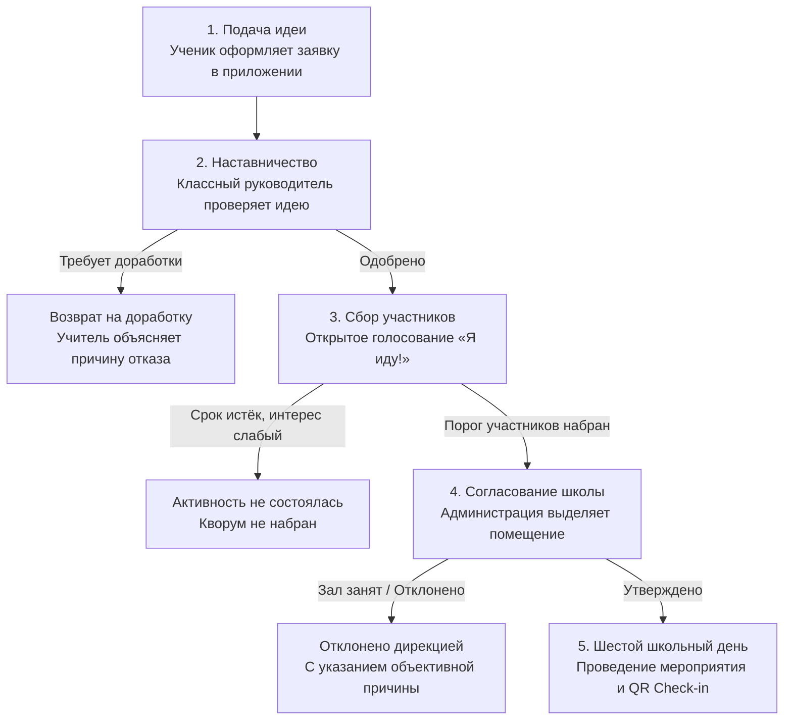
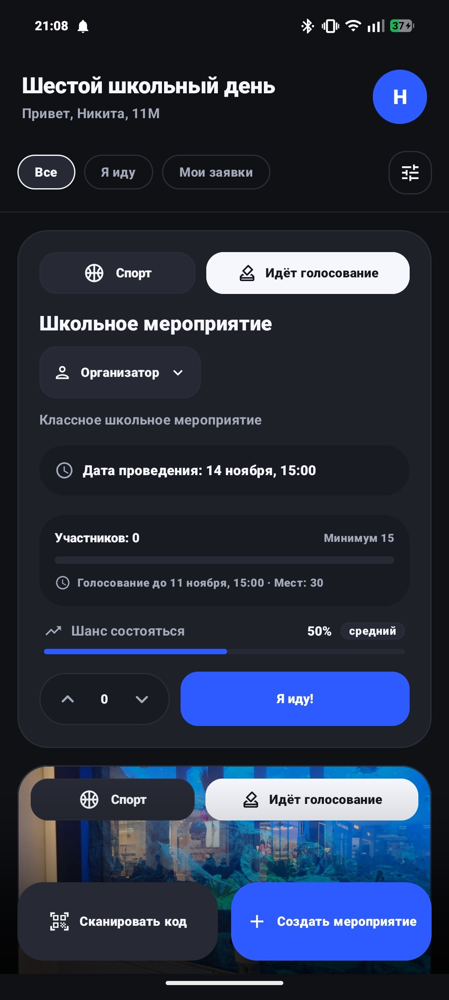
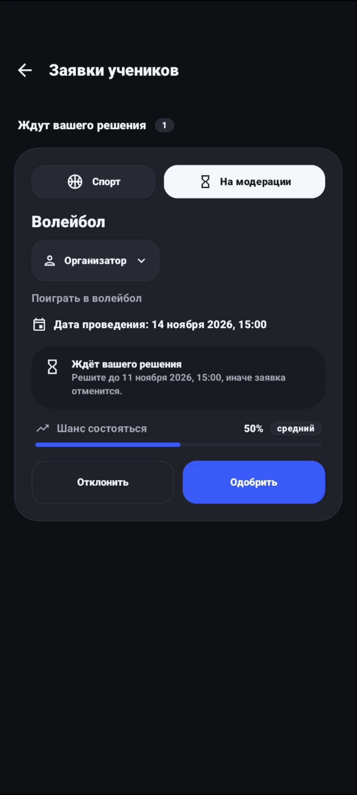
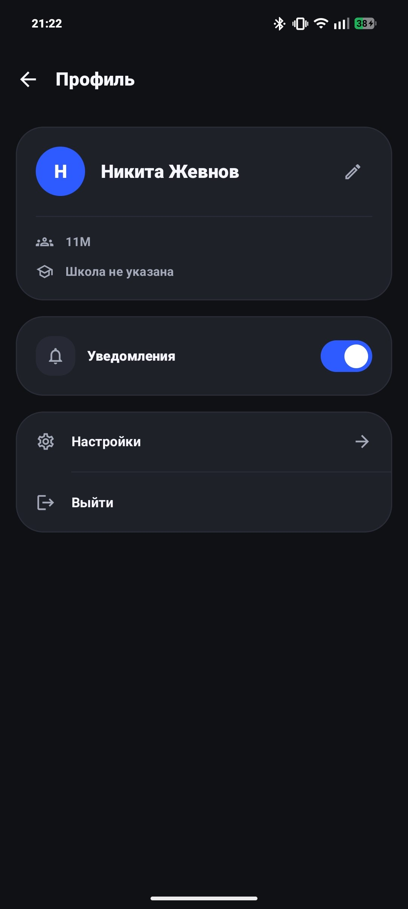
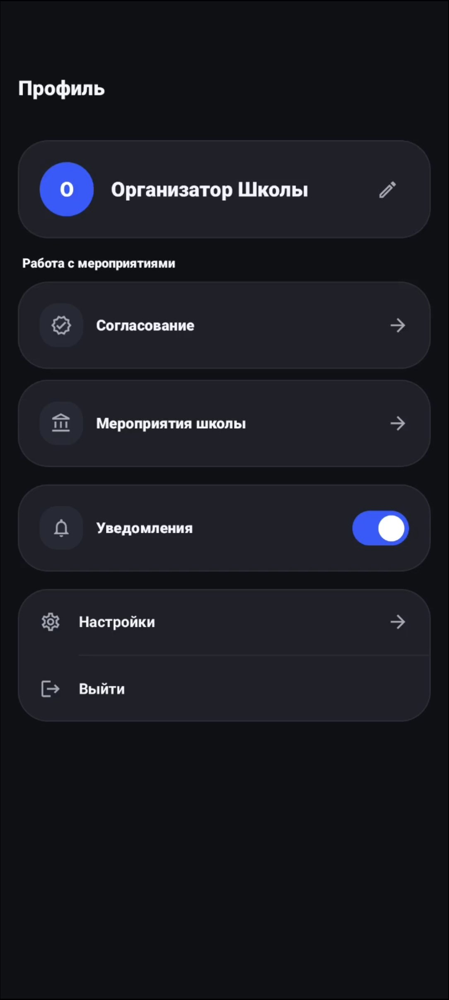

# Дорожная карта пользователя и пайплайн инициатив

В этом документе описан продуктовый путь пользователя, жизненный цикл школьной инициативы и сценарии взаимодействия для разных ролей в приложении **Kola («Шестой школьный день»)** простым языком — без перегрузки техническими терминами и кодом.

---

## Концепция продукта: от идеи до субботы

В школах Республики Беларусь шестой школьный день (суббота) традиционно посвящен внеклассным мероприятиям, кружкам, спорту и общению. Однако часто эти активности формируются сверху вниз, из-за чего школьники теряют к ним интерес.

**Kola** меняет этот подход и переводит инициативу в руки учеников:
1. **Любой школьник** может предложить идею на грядущую субботу.
2. **Классный руководитель** помогает скорректировать формат и обеспечивает безопасность.
3. **Одноклассники и друзья** открыто голосуют за участие — мероприятие состоится, только если набран реальный интерес (кворум).
4. **Администрация школы** выделяет необходимые ресурсы (спортзал, актовый зал, медиацентр).
5. **В субботу** ребята собираются вместе, подтверждая присутствие простым сканированием QR-кода.

---

## Пайплайн инициативы (Воронка шестого школьного дня)

Каждая предложенная активность проходит прозрачный 5-ступенчатый путь:

---

## 5 ключевых стадий жизненного цикла

### Стадия 1. Предложение инициативы (`На модерации`)
* **Главный герой**: Ученик-автор.
* **Что делает ученик**:
  - Нажимает кнопку создания активности и выбирает направление (Спорт, Настольные игры, Творчество, Экология, IT и др.).
  - Добавляет понятное название, описание формата («Что делаем?», «Что принести с собой?»).
  - Загружает обложку или тематическую картинку.
  - Задаёт порог участников: сколько ребят должно поддержать идею, чтобы она состоялась (например, 8 человек для турнира по волейболу).
  - Выбирает охват: только свой класс, параллель или вся школа.
* **Что видит ученик в приложении**:
  - Карточка отображает бейдж `На модерации`.
  - На таймлайне активности активен шаг **1: Создано**.
  - Инициатива пока не видна в общей ленте школы — она отправлена классному руководителю.

---

### Стадия 2. Первичная модерация наставником
* **Главный герой**: Классный руководитель.
* **В чём ценность этапа**: Учитель выступает доброжелательным наставником, отсекая спам, небезопасные или нереалистичные задумки, но поддерживая конструктивные предложения ребят.
* **Что делает учитель**:
  - Открывает вкладку **«Заявки»** своего класса.
  - Видит полную карточку с планом ученика.
  - Принимает решение:
    - **Поддержать**: активность мгновенно переходит на голосование и становится доступна в ленте.
    - **Вернуть на доработку**: учитель обязан написать понятный комментарий ученику (например: *«Отличная идея, но давай перенесём с 9:00 на 11:00, так как утром в кабинете факультатив»*).

---

### Стадия 3. Сбор участников и открытое голосование (`Идёт голосование`)
* **Главные герои**: Школьники (целевая аудитория).
* **Что происходит**:
  - Инициатива появляется в общей ленте событий школы.
  - Ребята изучают описание, смотрят, кто из друзей уже собирается пойти, ставят лайки.
  - Каждый желающий нажимает кнопку **«Я иду!»**.
  - На карточке активности в реальном времени заполняется шкала сбора участников:
    $$\text{Шкала готовности} = \frac{\text{Сколько уже идёт}}{\text{Требуемый порог}}$$
  - Ребята делятся ссылкой или показывают экран с QR-кодом прямо на перемене, привлекая одноклассников.
* **Результат**: Как только необходимое количество голосов набрано, заявка **автоматически** отправляется руководству школы.

---

### Стадия 4. Согласование школьной инфраструктуры (`У администрации`)
* **Главный герой**: Администрация школы (замдиректора по воспитательной работе, организатор).
* **Что делает администрация**:
  - Видит список инициатив, доказавших свою популярность и собравших кворум учеников.
  - Проверяет школьное расписание на субботу.
  - Назначает конкретное помещение: спортзал, актовый зал, читальный зал или кабинет информатики.
  - Нажимает **«Утвердить проведение»**.

---

### Стадия 5. Проведение в субботу (`Утверждено`)
* **Главные герои**: Все участники и ответственные педагоги.
* **Что видят ребята**:
  - Статус сменяется на бейдж `Утверждено`.
  - В карточке появляется точное время сбора и номер кабинета.
  - Формируется персональный QR-код активности.
* **В день мероприятия**:
  - Участники собираются в назначенном месте.
  - Ведущий или староста сканирует QR-коды участников для фиксации явки.

---

## Роли пользователей и сценарии использования (User Personas)

### 1. Максим, 10 «А» класс (Ученик-активист)
* **Цель**: Собрать одноклассников и параллель на чемпионат по настольным играм в субботу.
* **Его путь в Kola**:
  1. Входит в приложение через Schools.by.
  2. Создаёт инициативу «Турнир по Catan и Каркассону», устанавливает порог 12 человек.
  3. Получает push-уведомление, когда классный руководитель одобрил заявку.
  4. Показывает QR-код друзьям на перемене: за пару дней набирается 14 голосов «Я иду!».
  5. Получает push: *«Администрация утвердила турнир: суббота, 12:00, читальный зал библиотеки»*.

---

### 2. Ольга Сергеевна (Классный руководитель 10 «А»)
* **Цель**: Быть в курсе планов своих учеников, помогать им реализовывать полезные активности и отсеивать сомнительные идеи.
* **Её путь в Kola**:
  1. Заходит в раздел «Заявки» и видит новое предложение от Максима.
  2. Оценивает задумку: настольные игры развивают логику и сплачивают коллектив.
  3. В один клик одобряет инициативу, давая старт голосованию.
  4. Если бы идея требовала корректировки — написала бы комментарий, сохранив мотивацию ученика.

---

### 3. Игорь Владимирович (Заместитель директора по ВР)
* **Цель**: Рационально распределить ресурсы школы в субботу, поддержать вовлечённость ребят и избежать накладок по времени и помещениям.
* **Его путь в Kola**:
  1. Видит только те мероприятия, за которые ученики **уже проголосовали** и которые прошли фильтр классных руководителей.
  2. Смотрит занятость помещений: библиотека свободна с 12:00 до 15:00.
  3. Утверждает проведение и закрепляет кабинет.
  4. В конце месяца получает статистику самых популярных направлений среди школьников.

---

## Матрица возможностей по ролям (Product Permissions)

| Возможность в продукте | Ученик | Учитель | Администрация |
| :--- | :---: | :---: | :---: |
| Просмотр общей ленты событий субботы | + | + | + |
| Предложение новой инициативы | + | - | - |
| Прикрепление обложки и описания | + | - | - |
| Голосование «Я иду!» за участие | + *(кроме своих)* | - | - |
| Лайк и поддержка активности | + | + | + |
| Распространение и сканирование QR-кода | + | + | + |
| Первичная модерация заявок своего класса | - | + | - |
| Возврат заявки на доработку с комментарием | - | + *(класс)* | + *(школа)* |
| Выделение кабинетов и утверждение проведения | - | - | + |
| Настройка push-уведомлений о статусах | + | + | + |
| Выбор светлой/тёмной темы и языка интерфейса | + | + | + |

---

## Экраны приложения и пользовательский опыт

### 1. Лента мероприятий и открытое голосование учеников

  

* Просмотр инициатив субботы с разделением по категориям (Спорт, Творчество, IT).
* Подробная карточка с порогом участников, дедлайном голосования и предиктивным индикатором «Шанс состояться».
* Кнопка прямого участия «Я иду!», голосование за рейтинг и запуск сканера кодов.

### 2. Модерация и наставничество классного руководителя

  

* Входящая очередь заявок учеников своего класса со статусом «На модерации».
* Таймер контроля сроков рассмотрения до автоматической отмены заявки.
* Быстрое принятие педагогического решения: «Одобрить» или «Отклонить» с обязательным комментарием.

### 3. Профиль пользователя и панель организатора

  
  

* **Профиль ученика (слева)**: отображение класса (11М), школы, быстрый тумблер push-уведомлений и настройки оформления.
* **Кабинет организатора (справа)**: разделы согласования школьных мероприятий, доступ к общешкольным активностям и координация залов.
